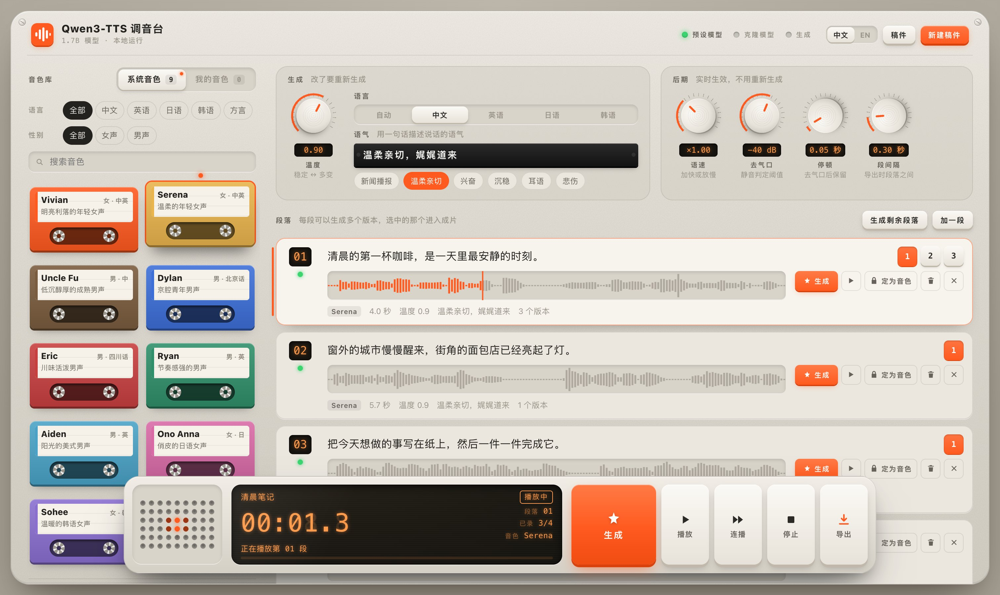
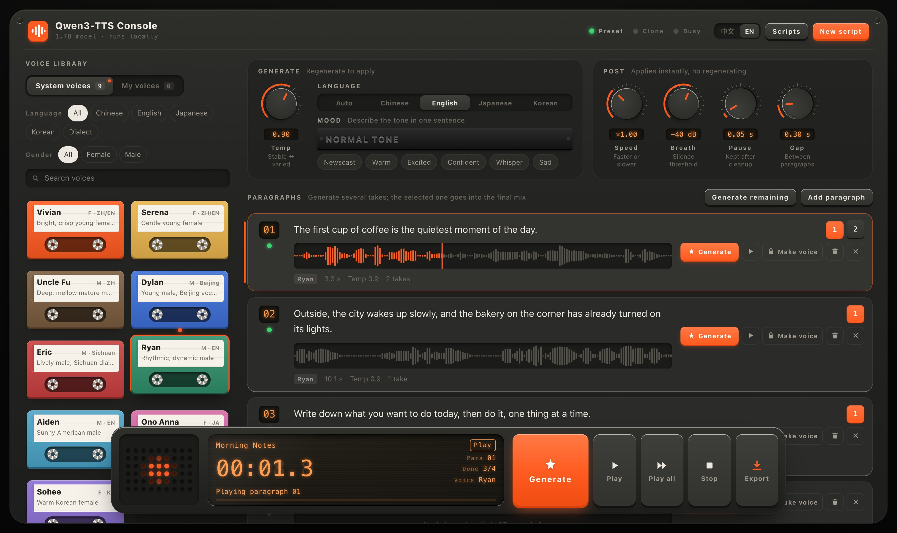
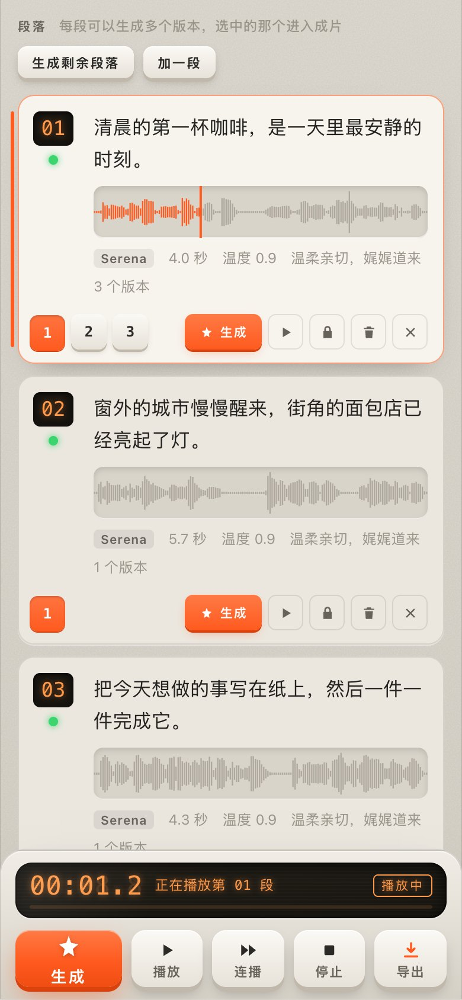

# Qwen3-TTS 调音台

在 Apple Silicon Mac 上本地运行的配音工作台，基于 [Qwen3-TTS](https://github.com/QwenLM/Qwen3-TTS) 和 [MLX](https://github.com/ml-explore/mlx)。外观和用法都像一台小型录音棚硬件：选一盘音色卡带，拧旋钮，按段落生成稿件，最后导出成片。

[English](README.md)



| 深色模式 | 手机 |
| --- | --- |
|  |  |

## 能做什么

- **以稿件为中心。** 粘贴稿件，按空行分段。每段可以生成多个版本，选中的那个进入成片。
- **长稿件全篇音色一致。** 某一段满意后点「定为音色」，这个版本就成了自定义音色，其余段落用它克隆生成。
- **音色库。** 模型自带的 9 个音色（中文、英语、日语、韩语，以及北京话、四川话），加上你自己克隆的音色，可以按语言、性别筛选。
- **免训练克隆。** 上传 5–15 秒的录音和对应原文，保存成一个有名字的音色，不需要训练。可选用 faster-whisper 自动听写原文。
- **后期不用重新生成。** 语速（不变调）、去气口、停顿长度、段落间隔都在播放和导出时用 ffmpeg 渲染，拧旋钮立刻能听到。
- **导出** 整篇 WAV、整篇 MP3，或每段一个 WAV 的压缩包，方便在剪辑软件里逐段对齐。每一段也可以单独下载。
- **完全在本机运行。** GPU 上一次只生成一条；模型按需载入，闲置 10 分钟自动卸载。
- 中英双语界面、浅色和深色模式、键盘快捷键，手机上也能用。

## 运行环境

- Apple Silicon 的 Mac。在 M5 Pro（64GB）上测试，生成时内存峰值约 6GB。
- Python 3.10 及以上（测试用的是 3.13），以及 [ffmpeg](https://ffmpeg.org)（`brew install ffmpeg`）。
- 两个模型约占 6GB 磁盘。

## 快速开始

```bash
git clone https://github.com/shisaq/qwen3-tts-console.git
cd qwen3-tts-console
python3 -m venv .venv
.venv/bin/pip install -r requirements.txt

# 两个 8-bit MLX 模型（各约 3GB）
.venv/bin/hf download mlx-community/Qwen3-TTS-12Hz-1.7B-CustomVoice-8bit --local-dir models/Qwen3-TTS-12Hz-1.7B-CustomVoice-8bit
.venv/bin/hf download mlx-community/Qwen3-TTS-12Hz-1.7B-Base-8bit --local-dir models/Qwen3-TTS-12Hz-1.7B-Base-8bit

.venv/bin/python ttsd.py
```

然后打开 <http://127.0.0.1:18400>。系统音色用 CustomVoice 模型，克隆用 Base 模型；只需要其中一种的话，只下载对应的那个即可。

## 配置

设置从 `~/.config/ttsd/config.json` 读取（也可以用环境变量 `TTSD_CONFIG` 指定文件）。每一项都可以省略，参见 [`config.example.json`](config.example.json)。

| 键 | 默认值 | 含义 |
| --- | --- | --- |
| `host`、`port` | `127.0.0.1`、`18400` | 监听地址和端口 |
| `models_dir` | `models` | 存放模型文件夹的目录（相对于仓库） |
| `preset_model`、`clone_model` | 1.7B 8-bit 模型 | `models_dir` 里的文件夹名 |
| `data_dir` | `~/.local/share/ttsd` | 稿件、版本、自定义音色、导出文件 |
| `ffmpeg` | 从 `PATH` 查找 | ffmpeg 的路径 |
| `transcribe_python` | 关闭 | 装有 `faster-whisper` 的 Python 解释器；设置后可以自动听写参考录音 |
| `whisper_model` | `base` | faster-whisper 模型名 |
| `idle_unload_minutes` | `10` | 闲置多少分钟后卸载模型 |
| `device_name` | 空 | 显示在铭牌上 |
| `home_url` | 空 | 在顶栏加一个「返回首页」链接 |
| `tuned_voices` | `{}` | 微调过的单人模型（转成 MLX 的 `custom_voice` 检查点），例如 `{"me": {"name": "我", "model": "tuned/me-8bit", "speaker": "me", "gender": "m", "lang": "zh"}}`。`model` 相对于 `models_dir`；`speaker` 是检查点 `spk_id` 里的名字。显示在「我的音色」里，生成时语言固定为 auto，不支持语气描述 |

## 使用方法

1. 点「新建稿件」，粘贴文字，每个用空行隔开的段落成为一段。
2. 在**音色库**里选一个音色。系统音色可以写**语气**（如「沉稳有力，有说服力」，中英文都行），**语言**可以指定，也可以留在「自动」。
3. 点某一段的「生成」（或按 <kbd>G</kbd>）。再点一次会生成另一个版本，点版本编号可以对比试听。
4. 某一段满意后点「定为音色」，再点「生成剩余段落」（<kbd>A</kbd>），其余段落就用同一个音色生成。
5. 边听边调**语速**、**去气口**、**停顿**和**段间隔**，最后**导出**。

快捷键：<kbd>G</kbd> 生成当前段 · <kbd>A</kbd> 生成剩余段落 · <kbd>空格</kbd> 播放/暂停 · <kbd>Shift</kbd>+<kbd>空格</kbd> 连播 · <kbd>↑</kbd><kbd>↓</kbd> 切换段落 · <kbd>1</kbd>–<kbd>9</kbd> 选择版本 · <kbd>⌘</kbd><kbd>回车</kbd> 编辑时直接生成 · <kbd>B</kbd> 导出 · <kbd>Esc</kbd> 停止。

### 克隆的要点

- 单人、背景安静、5–15 秒的录音效果最好，并不是越长越好。
- 参考文本必须和录音**一字不差**，音色像不像主要取决于它。自动听写的结果一定要逐字核对。
- 克隆音色的语气来自参考录音，所以自定义音色不能填写语气。
- 这里用的是免训练克隆。Qwen3-TTS 也支持为单个音色做微调，但官方流程面向 CUDA 显卡，不在本项目范围内。

## 微调自己的声音

几秒参考音频的零样本复刻，音色和口音常常不够像。[`finetune/`](finetune/README.zh-CN.md) 能在同一台 Mac 上把一个人的录音训练成微调音色（64 GB 的 Mac mini 训练 18 分钟语音用了 17 分钟；0.6B 模型冻结部分层，内存峰值不到 12 GB），带转写复核页和挑选版本的对比页。结果写进 `tuned_voices`，就会出现在「我的音色」里。

## 后台运行

[`launchd/com.example.ttsd.plist`](launchd/com.example.ttsd.plist) 可以让服务在 macOS 登录时自动启动。把里面的路径改成你的，复制到 `~/Library/LaunchAgents/`，再运行 `launchctl bootstrap gui/$(id -u) ~/Library/LaunchAgents/com.example.ttsd.plist`。

## 安全

服务没有登录功能，默认只监听 `127.0.0.1`。要在其他设备上用，请放在只有你自己的设备能访问的反向代理后面（例如 Tailscale 这类 VPN，或带身份验证的代理）。不要直接暴露到公网。

## 说明

- **MLX 必须是 0.32 或更新版本。** 在 M5 一代的 GPU 上用 MLX 0.30 时，生成的语音约每 1.2 秒就有一整块变成数字静音，而且不报错。
- 模型自带的 `speed` 参数不生效，所以语速放在后期处理里。
- 第一次播放时会打开声音输出并保持常开，避免蓝牙和 HDMI 输出吞掉每段开头。

## 测试

```bash
.venv/bin/python -m unittest discover tests
```

测试覆盖分段、设置校验、后期处理和 HTTP 接口，不需要模型。

## 致谢与许可

- Qwen 团队的 [Qwen3-TTS](https://github.com/QwenLM/Qwen3-TTS)；MLX 版本由 [mlx-community](https://huggingface.co/mlx-community) 转换
- [mlx-audio](https://github.com/Blaizzy/mlx-audio)，让 Qwen3-TTS 在 MLX 上运行
- [faster-whisper](https://github.com/SYSTRAN/faster-whisper)，用于可选的自动听写
- [FunASR](https://github.com/modelscope/FunASR)（Paraformer、CAM++），用于准备微调数据；`finetune/qwen_dataset.py` 来自 Qwen3-TTS（Apache-2.0）

本仓库代码以 [MIT 许可证](LICENSE) 发布。模型不包含在仓库内，并各自遵循其许可证。
